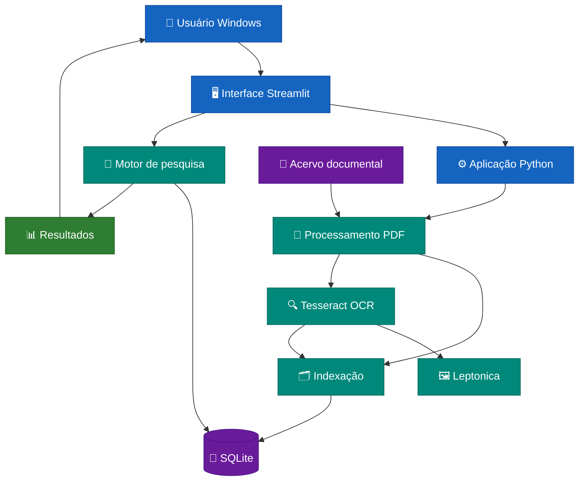
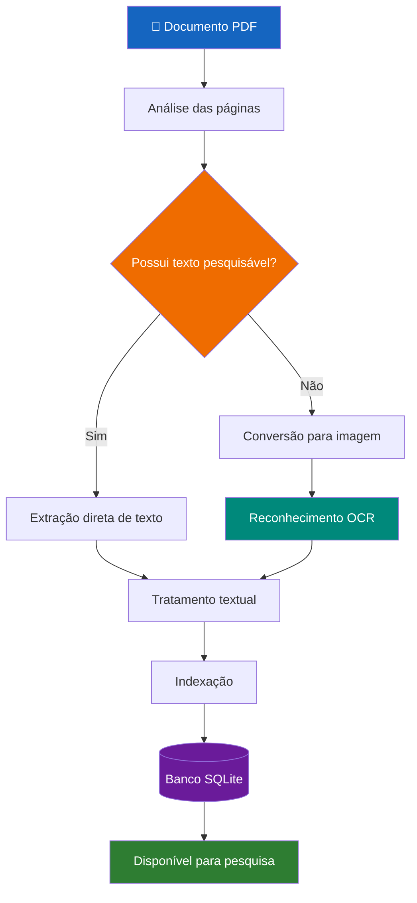
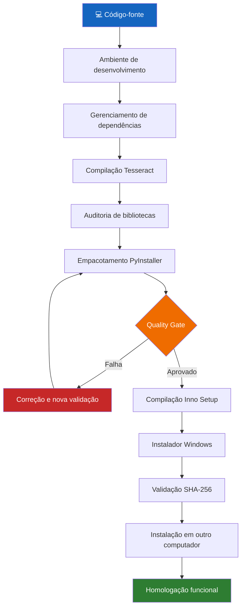
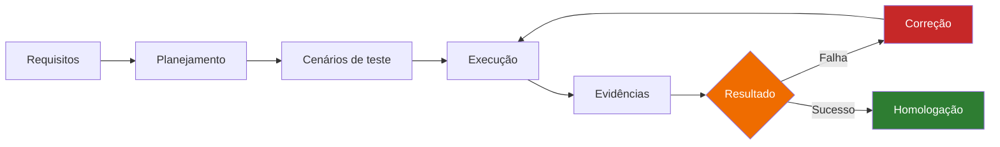
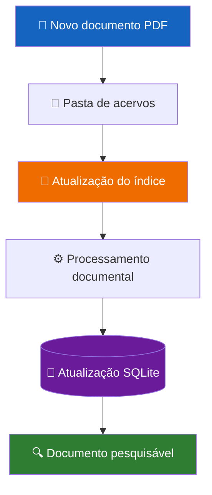

# 📂 CASSI – Acervo Inteligente

### Transformando documentos técnicos em conhecimento acessível

---

## 📌 Sobre o projeto

O **CASSI – Acervo Inteligente** é uma solução tecnológica desenvolvida para automatizar a organização, o processamento, a indexação e a recuperação de informações presentes em documentos técnicos do setor de engenharia civil.

A aplicação integra técnicas de reconhecimento óptico de caracteres (OCR), processamento de documentos PDF, busca textual, correspondência aproximada e persistência de dados, permitindo a localização de informações técnicas de forma simplificada.

O projeto foi desenvolvido para atender a uma necessidade empresarial real, aplicando práticas de Engenharia de Software, DevOps, Quality Assurance, automação e gestão de dependências.

A solução possui arquitetura de execução local e distribuição por meio de um instalador Windows, proporcionando autonomia operacional ao usuário final.

---

## 📑 Sumário

- [Contextualização](#-contextualização)
- [Objetivos](#-objetivos)
- [Funcionalidades](#-funcionalidades)
- [Stack tecnológica](#-stack-tecnológica)
- [Arquitetura](#-arquitetura-da-solução)
- [Processamento documental](#-fluxo-de-processamento-documental)
- [Etapas do desenvolvimento](#-etapas-do-desenvolvimento)
- [DevOps e automação](#-devops-e-automação)
- [Quality Assurance](#-quality-assurance)
- [Segurança](#-segurança-e-integridade)
- [Resultados](#-resultados-alcançados)
- [Instalação](#-instalação)
- [Atualização de acervos](#-atualização-de-acervos)
- [Desafios técnicos](#-desafios-técnicos)
- [Roadmap](#-roadmap)
- [Documentação](#-documentação)
- [Autoria](#-autoria)

---

## 🎯 Contextualização

Empresas do setor de engenharia civil possuem grandes volumes de documentos utilizados para comprovação de capacidade técnica e participação em processos licitatórios.

A pesquisa manual nesses documentos pode apresentar dificuldades relacionadas a:

- Grande quantidade de documentos e páginas;
- Documentos antigos e digitalizados;
- Ausência de conteúdo textual pesquisável;
- Diferentes nomenclaturas para um mesmo serviço;
- Dificuldade na localização de informações específicas;
- Identificação de unidades de medida e documentos comprobatórios;
- Tempo dedicado à análise documental.

O CASSI foi desenvolvido para transformar esse acervo em uma base de informações pesquisável, facilitando a recuperação de evidências técnicas.

---

## 🚀 Objetivos

### Objetivo geral

Automatizar o processamento e a pesquisa de documentos técnicos, facilitando o acesso às informações presentes no acervo empresarial.

### Objetivos específicos

- Extrair conteúdo textual de documentos PDF.
- Aplicar OCR em documentos digitalizados.
- Processar documentos digitais, digitalizados e mistos.
- Indexar informações para recuperação posterior.
- Implementar pesquisa textual e aproximada.
- Ampliar a pesquisa utilizando termos relacionados.
- Identificar documentos e páginas de origem.
- Preservar a integridade dos arquivos originais.
- Permitir atualização incremental do acervo.
- Automatizar o empacotamento e a distribuição.
- Validar a execução em ambientes independentes.

---

## ⚙️ Funcionalidades

| Funcionalidade | Descrição |
|---|---|
| 📄 Processamento de PDFs | Leitura e extração de conteúdo documental |
| 🔍 OCR | Reconhecimento de texto em páginas digitalizadas |
| 🗂️ Indexação | Organização das informações para pesquisa |
| 🔎 Pesquisa textual | Localização de palavras e expressões |
| 🧠 Busca aproximada | Recuperação de termos com variações textuais |
| 🔗 Termos relacionados | Ampliação das possibilidades de pesquisa |
| 📍 Rastreabilidade | Identificação do documento de origem |
| 💾 Persistência | Armazenamento local em SQLite |
| 🔄 Atualização incremental | Inclusão de novos documentos após a instalação |
| 📊 Indicadores | Acompanhamento do processamento documental |
| 🖥️ Interface gráfica | Utilização por meio de navegador local |
| 📦 Distribuição | Instalador independente para Windows |
| 🔐 Integridade | Verificação de arquivos utilizando SHA-256 |

---

## 🛠️ Stack tecnológica

### Desenvolvimento

### Processamento documental

### DevOps, build e automação

### Qualidade e segurança

### Inteligência artificial como apoio ao desenvolvimento

| Tecnologia | Responsabilidade |
|---|---|
| Python 3.12 | Desenvolvimento e processamento |
| Streamlit | Interface gráfica local |
| SQLite | Persistência de dados |
| PyMuPDF | Processamento de PDFs |
| Tesseract OCR | Reconhecimento óptico de caracteres |
| Leptonica | Processamento de imagens |
| PowerShell | Automação de build e validação |
| Git | Controle de versão |
| vcpkg | Gerenciamento de dependências nativas |
| CMake | Configuração de compilação |
| MSVC | Compilação de componentes C/C++ |
| Visual Studio Build Tools | Ambiente de compilação |
| PyInstaller | Empacotamento da aplicação |
| Inno Setup | Geração do instalador Windows |
| SHA-256 | Verificação de integridade |
| OpenAI Codex | Apoio à implementação e investigação técnica |

---

## 🏗️ Arquitetura da solução

A aplicação utiliza uma arquitetura local, com separação lógica entre apresentação, processamento documental, reconhecimento óptico, pesquisa, persistência e distribuição.

### Componentes da arquitetura

| Camada | Responsabilidade |
|---|---|
| Apresentação | Interação com o usuário |
| Aplicação | Orquestração das funcionalidades |
| Processamento | Extração de informações dos PDFs |
| OCR | Reconhecimento de conteúdo digitalizado |
| Indexação | Preparação das informações para pesquisa |
| Persistência | Armazenamento local dos dados |
| Pesquisa | Recuperação de informações |
| Distribuição | Empacotamento e instalação |

---

## 🔄 Fluxo de processamento documental

O processamento considera três categorias documentais:

| Categoria | Estratégia |
|---|---|
| PDF digital | Extração direta de texto |
| PDF digitalizado | Reconhecimento óptico de caracteres |
| PDF misto | Combinação de extração textual e OCR |

---

## 📋 Etapas do desenvolvimento

### Fase 01 — Discovery e requisitos

- Identificação do problema empresarial.
- Levantamento dos requisitos.
- Análise dos documentos.
- Definição do escopo.
- Identificação das restrições operacionais.

### Fase 02 — Arquitetura

- Seleção das tecnologias.
- Definição da arquitetura local.
- Planejamento da persistência.
- Definição da estratégia de processamento.

### Fase 03 — Desenvolvimento

- Preparação do ambiente Python.
- Implementação da aplicação.
- Integração com SQLite.
- Integração com Tesseract OCR.
- Desenvolvimento da interface Streamlit.

### Fase 04 — Processamento e indexação

- Extração de conteúdo textual.
- Processamento de páginas digitalizadas.
- Indexação documental.
- Persistência das informações.
- Associação aos documentos de origem.

### Fase 05 — Mecanismo de pesquisa

- Pesquisa por palavras-chave.
- Pesquisa por expressões técnicas.
- Correspondência aproximada.
- Pesquisa por termos relacionados.

### Fase 06 — Quality Assurance

- Testes com dados sintéticos.
- Validação de processamento documental.
- Testes de integração.
- Verificação de integridade.
- Análise e correção de inconsistências.

### Fase 07 — Auditoria de dependências

- Análise das bibliotecas distribuídas.
- Identificação de dependências nativas.
- Avaliação de licenciamento.
- Verificação dos componentes OCR.

### Fase 08 — Compilação

- Configuração do Visual Studio Build Tools.
- Configuração do compilador MSVC.
- Preparação do CMake e vcpkg.
- Compilação do Tesseract 5.5.4.
- Validação das bibliotecas geradas.

### Fase 09 — Build e empacotamento

- Configuração do PyInstaller.
- Inclusão das dependências.
- Geração do executável.
- Organização dos recursos.
- Inclusão dos avisos de licenciamento.

### Fase 10 — Distribuição

- Geração do instalador com Inno Setup.
- Validação do pacote.
- Verificação SHA-256.
- Instalação em ambiente independente.

### Fase 11 — Homologação

- Validação da instalação.
- Validação do funcionamento.
- Validação da atualização de novos acervos.
- Registro dos resultados.

---

## ♾️ DevOps e automação

O projeto aplica práticas de DevOps relacionadas à automação de build, gerenciamento de dependências, empacotamento, controle de qualidade e distribuição de software.

### Pipeline de build e distribuição

### Práticas aplicadas

- Automação por scripts PowerShell.
- Gerenciamento de dependências.
- Compilação de componentes nativos.
- Separação entre desenvolvimento e distribuição.
- Validação de artefatos.
- Verificação de integridade.
- Quality Gates no processo de build.
- Auditoria de componentes de terceiros.
- Release Management.
- Troubleshooting.
- Validação em ambiente independente.

### Artefato de distribuição

| Propriedade | Valor |
|---|---|
| Artefato | CASSI-Setup-1.0.0.exe |
| Versão | 1.0.0 |
| Plataforma | Windows |
| Arquitetura | x64 |
| Tamanho | Aproximadamente 584 MiB |
| Empacotamento | PyInstaller |
| Instalador | Inno Setup |
| Integridade | SHA-256 |
| Validação externa | Bem-sucedida |

O pipeline atual utiliza automação local. A implementação de CI/CD em plataformas como GitHub Actions está prevista como evolução futura.

---

## 🧪 Quality Assurance

A estratégia de qualidade foi incorporada ao ciclo de desenvolvimento, contemplando validações funcionais, técnicas, de integração e de distribuição.

### Estratégia de testes

### Matriz de validação

| ID | Cenário | Tipo | Status |
|---|---|---|---|
| CT01 | Processamento de PDF digital | Funcional | 🟡 Evidência individual a consolidar |
| CT02 | Processamento de PDF digitalizado | Integração | 🟡 Evidência individual a consolidar |
| CT03 | Processamento de PDF misto | Integração | 🟡 Evidência individual a consolidar |
| CT04 | Pesquisa textual | Funcional | 🟡 Evidência individual a consolidar |
| CT05 | Pesquisa aproximada | Funcional | 🟡 Evidência individual a consolidar |
| CT06 | Pesquisa por termos relacionados | Funcional | 🟡 Evidência individual a consolidar |
| CT07 | Integridade do banco SQLite | Integridade | 🟢 Validado |
| CT08 | OCR com dados sintéticos em português | Integração | 🟢 Validado |
| CT09 | OCR com dados sintéticos em inglês | Integração | 🟢 Validado |
| CT10 | Compilação do Tesseract | Build | 🟢 Validado |
| CT11 | Validação do bundle OCR | Integração | 🟢 Validado |
| CT12 | Geração do instalador | Build | 🟢 Validado |
| CT13 | Verificação SHA-256 | Integridade | 🟢 Validado |
| CT14 | Instalação em outro computador | Instalação | 🟢 Validado |
| CT15 | Funcionamento em outro computador | Sistema | 🟢 Validado |
| CT16 | Inclusão de novos acervos | Funcional | 🟢 Validado |
| CT17 | Atualização do índice | Integração | 🟢 Validado |
| CT18 | Funcionamento após reinicialização | Recuperação | 🟡 A formalizar |
| CT19 | Funcionamento offline | Sistema | 🟡 A formalizar |
| CT20 | Backup e restauração | Recuperação | 🟡 A formalizar |

### Critérios de qualidade

- Preservação dos documentos originais.
- Integridade do banco de dados.
- Consistência dos artefatos gerados.
- Validação das dependências.
- Rastreabilidade dos resultados.
- Independência do ambiente de desenvolvimento.

---

## 🔐 Segurança e integridade

O projeto considera a proteção das informações empresariais e a integridade dos componentes distribuídos.

### Controles adotados

- Processamento local dos documentos.
- Persistência local das informações.
- Separação entre dados reais e sintéticos.
- Preservação dos documentos originais.
- Verificação de integridade utilizando SHA-256.
- Auditoria de bibliotecas nativas.
- Validação de dependências.
- Inclusão de avisos de licenciamento.
- Controle dos artefatos de distribuição.
- Restrição de publicação dos documentos empresariais.

### Auditoria da cadeia de dependências

Durante a preparação do instalador, foi identificada uma dependência relacionada à biblioteca JBIG no pacote inicial do Tesseract.

Como estratégia de mitigação, foi realizada uma nova compilação do Tesseract utilizando vcpkg, com redução de recursos opcionais desnecessários ao projeto.

O processo envolveu:

1. Análise das dependências.
2. Preparação de ambiente isolado de compilação.
3. Compilação do Tesseract 5.5.4.
4. Inspeção das bibliotecas DLL.
5. Verificação dos componentes distribuídos.
6. Testes funcionais do OCR.
7. Inclusão dos avisos de licenciamento.

A inspeção realizada não identificou indicadores da dependência JBIG no novo bundle auditado.

---

## 📊 Resultados alcançados

| Indicador | Resultado |
|---|---:|
| 📄 Documentos do acervo inicial | 82 |
| 📑 Páginas indexadas | 683 |
| 🗂️ Documentos indexados | 82 |
| 📈 Cobertura do acervo inicial | 100% |
| ⚙️ Versão do Tesseract | 5.5.4 |
| 📦 Executáveis e modelos auditados | 21 |
| 🔧 Bibliotecas DLL auditadas | 17 |
| 📜 Avisos de licenciamento incluídos | 16 |
| ⏱️ Tempo registrado de compilação | 23 minutos |
| 🚀 Versão do instalador | 1.0.0 |
| 🖥️ Instalação em outro computador | Validada |
| 🔄 Atualização de novos acervos | Validada |

### Principais entregas

- Aplicação funcional.
- Base documental indexada.
- Mecanismo de reconhecimento óptico.
- Pesquisa textual e aproximada.
- Interface gráfica local.
- Pipeline de build automatizado.
- Instalador Windows.
- Validação de integridade.
- Instalação em ambiente independente.
- Atualização incremental do acervo.

---

## 💻 Instalação

### Requisitos recomendados

| Requisito | Configuração |
|---|---|
| Sistema operacional | Windows 10 ou 11 |
| Arquitetura | 64 bits |
| Memória RAM | 8 GB ou superior |
| Armazenamento | 5 GB livres, como estimativa inicial |
| Navegador | Navegador web compatível |

### Procedimento

1. Obter o instalador autorizado.
2. Validar a integridade do arquivo.
3. Executar o instalador.
4. Seguir as instruções do assistente.
5. Concluir a instalação.
6. Acessar o atalho CASSI na área de trabalho.
7. Validar a abertura da aplicação.

A aplicação foi empacotada para reduzir a necessidade de instalação manual de ferramentas de desenvolvimento.

O instalador empresarial não está disponível neste repositório por conter informações de uso restrito.

---

## 🔄 Atualização de acervos

A aplicação permite a inclusão de novos documentos após a instalação.

### Procedimento

1. Copiar o novo PDF para a pasta de acervos.
2. Abrir o CASSI.
3. Executar a atualização do índice.
4. Aguardar o processamento.
5. Realizar uma pesquisa para validar o novo documento.

A atualização de novos acervos foi executada com sucesso após a instalação da versão 1.0.0.

Não foi necessária a recompilação ou reinstalação da aplicação.

Cada computador possui uma instalação independente. As atualizações documentais não são sincronizadas automaticamente entre computadores.

---

## 🧩 Desafios técnicos

| Desafio | Solução aplicada |
|---|---|
| PDFs sem texto pesquisável | Integração com Tesseract OCR |
| Documentos com conteúdo misto | Combinação de extração textual e OCR |
| Variações de nomenclatura | Pesquisa aproximada e termos relacionados |
| Preservação de dados | Verificações de integridade |
| Dependência relacionada ao JBIG | Nova compilação via vcpkg |
| Compilação de bibliotecas nativas | Configuração do MSVC e CMake |
| Falhas de conexão durante clone | Shallow clone e configuração HTTP/1.1 |
| Restrições de armazenamento | Utilização de unidade alternativa |
| Falhas de permissão | Isolamento do ambiente de build |
| Inconsistências Tcl/Tk | Configuração das variáveis de ambiente |
| Falha na validação do bundle OCR | Correção dos scripts de distribuição |
| Avisos de licença ausentes | Ajustes no empacotamento |
| Dependência do ambiente Python | Empacotamento com PyInstaller |
| Distribuição para outros computadores | Instalador Windows |

---

## 📸 Evidências do projeto

As evidências técnicas serão disponibilizadas na pasta:

`assets/screenshots/`

As imagens deverão demonstrar:

- Interface principal.
- Pesquisa inteligente.
- Atualização de novos acervos.
- Processamento OCR.
- Compilação do Tesseract.
- Geração do instalador.
- Validação SHA-256.
- Aplicação instalada em outro computador.

Todas as evidências públicas deverão utilizar informações anonimizadas ou sintéticas.

---

## 🗺️ Roadmap

### Versão 1.0.0

- [x] Desenvolvimento da aplicação.
- [x] Integração com SQLite.
- [x] Integração com OCR.
- [x] Indexação documental.
- [x] Implementação da pesquisa.
- [x] Compilação do Tesseract.
- [x] Automação do build.
- [x] Geração do instalador.
- [x] Validação SHA-256.
- [x] Instalação em outro computador.
- [x] Atualização de novos acervos.

### Evoluções futuras

- [ ] Formalização dos testes de recuperação.
- [ ] Automação de backup e restauração.
- [ ] Ampliação dos testes automatizados.
- [ ] Aprimoramento da identificação de unidades de medida.
- [ ] Extração estruturada de informações técnicas.
- [ ] Geração de relatórios.
- [ ] Comparação entre requisitos de editais e acervos.
- [ ] Implementação de CI/CD.
- [ ] Avaliação de busca semântica avançada.
- [ ] Avaliação de arquitetura centralizada ou em nuvem.

---

## 📚 Documentação

| Documento | Descrição |
|---|---|
| [Arquitetura](docs/arquitetura.md) | Arquitetura lógica e componentes |
| [Requisitos](docs/requisitos.md) | Requisitos funcionais e não funcionais |
| [Pipeline de build](docs/pipeline-build.md) | Compilação e distribuição |
| [Plano de testes](docs/plano-de-testes.md) | Estratégia de qualidade |
| [Homologação](docs/homologacao.md) | Registro dos resultados |
| [Manual de instalação](docs/manual-instalacao.md) | Procedimento de instalação |
| [Manual do usuário](docs/manual-usuario.md) | Orientações de utilização |
| [Licenciamento](docs/licenciamento.md) | Dependências e conformidade |
| [Changelog](CHANGELOG.md) | Histórico de versões |
| [Security](SECURITY.md) | Política de segurança |

---

## ⚠️ Limitações conhecidas

A precisão do OCR depende da qualidade dos documentos digitalizados.

Caracteres especiais, símbolos e unidades de medida podem apresentar inconsistências durante o reconhecimento.

Foi identificada, em teste sintético, uma limitação relacionada ao reconhecimento de unidades como m³ e m².

A aplicação é uma ferramenta de apoio à pesquisa documental. As informações recuperadas devem ser conferidas nos documentos originais antes de sua utilização como evidência técnica.

A validação ampliada de recuperação, funcionamento offline e condições de redistribuição permanece como ponto de acompanhamento.

---

## 📜 Licenciamento e confidencialidade

Este repositório possui finalidade técnica e demonstrativa.

Os documentos empresariais originais, bancos de dados reais, instaladores empresariais e informações confidenciais não são disponibilizados publicamente.

A distribuição da aplicação deve respeitar as licenças dos componentes utilizados, incluindo as obrigações aplicáveis à AGPL-3.0 e às bibliotecas de terceiros.

A publicação de código-fonte empresarial depende das autorizações aplicáveis, sem prejuízo das obrigações de fornecimento de código correspondente aos destinatários da aplicação.

---

## 🤖 Desenvolvimento assistido por inteligência artificial

O projeto utilizou ferramentas de inteligência artificial generativa como apoio às atividades de:

- Desenvolvimento de software.
- Análise técnica.
- Investigação de falhas.
- Revisão de código.
- Automação de scripts.
- Análise de dependências.
- Preparação de testes.
- Documentação técnica.

As decisões de negócio, autorizações, validações e homologações foram conduzidas com supervisão humana.

---

## 👩‍💻 Autoria

### Andréa Correia

**Arquiteta Cloud | DevOps | Quality Assurance**

Profissional de tecnologia, com dupla graduação em Matemática e Análise e Desenvolvimento de Sistemas.

O projeto representa a integração entre experiência de negócio, engenharia civil, tecnologia da informação, automação e qualidade de software.

### Competências aplicadas

- Engenharia de Software
- DevOps
- Quality Assurance
- Python
- Automação
- Processamento documental
- OCR
- Banco de dados
- Gestão de dependências
- Segurança e integridade
- Troubleshooting
- Release Management

---

⭐ Projeto desenvolvido para solucionar uma necessidade empresarial real por meio da tecnologia.

**CASSI – Acervo Inteligente | 2026**
