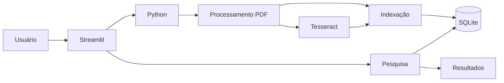
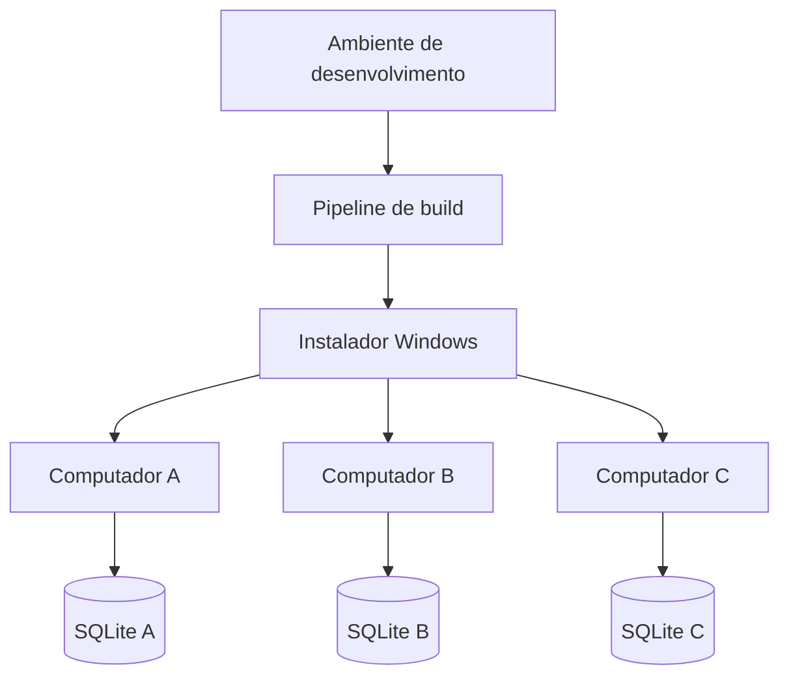

# 🏗️ Arquitetura da Solução

## 1. Visão geral

O CASSI – Acervo Inteligente utiliza arquitetura local, com interface web executada no próprio computador e persistência de dados em SQLite.

## 2. Decisões arquiteturais

| Decisão | Justificativa |
|---|---|
| Execução local | Privacidade e autonomia operacional |
| SQLite | Persistência sem servidor externo |
| Streamlit | Interface simplificada |
| Python | Integração com ferramentas documentais |
| Tesseract | Reconhecimento de conteúdo digitalizado |
| Instalador Windows | Simplificação da distribuição |
| Instalações independentes | Autonomia por computador |

## 3. Arquitetura lógica

## 4. Arquitetura de implantação

Cada instalação possui sua própria base documental e seu próprio banco de dados.

## 5. Comunicação local

A interface utiliza um servidor Streamlit local, configurado durante o desenvolvimento na porta 8504.

## 6. Persistência

O SQLite armazena as informações processadas e indexadas.

Os documentos PDF originais são mantidos separadamente.

## 7. Restrições

- Dependência dos recursos computacionais locais.
- Precisão do OCR condicionada à qualidade documental.
- Ausência de sincronização automática entre instalações.
- Necessidade de política de backup.

## 8. Evoluções arquiteturais

- Busca semântica avançada.
- Armazenamento centralizado.
- Sincronização de documentos.
- Arquitetura em nuvem.
- Automação de CI/CD.
