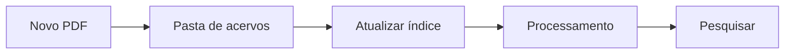

# 📖 Manual do Usuário

## 1. Acessar a aplicação

1. Localizar o atalho CASSI na área de trabalho.
2. Clicar duas vezes sobre o atalho.
3. Aguardar a abertura da interface.

## 2. Realizar uma pesquisa

1. Informar a palavra ou expressão desejada.
2. Habilitar correspondências aproximadas, se necessário.
3. Habilitar termos relacionados, se necessário.
4. Executar a pesquisa.
5. Analisar os resultados.
6. Consultar o documento original.

## 3. Exemplo de pesquisa

Expressão:

`Tratamento Superficial Duplo`

A aplicação deverá recuperar as correspondências existentes na base indexada.

## 4. Adicionar novos acervos

1. Localizar a pasta de acervos configurada.
2. Copiar o novo documento PDF.
3. Abrir o CASSI.
4. Executar a atualização do índice.
5. Aguardar a conclusão.
6. Pesquisar informações do novo documento.

Não é necessário reinstalar a aplicação para adicionar novos documentos.

## 5. Boas práticas

- Preservar os documentos originais.
- Manter backups periódicos.
- Conferir informações recuperadas pelo OCR.
- Evitar alterações manuais no banco SQLite.
- Aguardar a conclusão do processamento.
- Não interromper a atualização do índice.

## 6. Instalações independentes

A inclusão de um documento em um computador não atualiza automaticamente os demais computadores.

O procedimento deverá ser realizado em cada instalação, conforme a necessidade empresarial.
