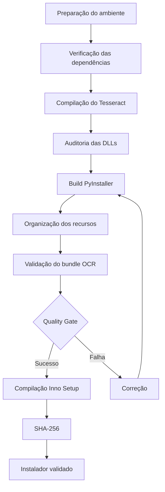

# ♾️ Pipeline de Build e Distribuição

## 1. Objetivo

Documentar o processo de compilação, empacotamento, validação e distribuição da aplicação.

## 2. Ferramentas

- Python 3.12
- PowerShell
- Git
- Visual Studio Build Tools 2022
- MSVC v143
- CMake
- vcpkg
- PyInstaller
- Inno Setup

## 3. Fluxo de build



## 4. Compilação do OCR

O Tesseract 5.5.4 foi compilado utilizando vcpkg e MSVC para Windows x64.

A compilação foi realizada com redução de recursos opcionais desnecessários.

## 5. Empacotamento

O PyInstaller foi utilizado para gerar o executável e organizar as dependências da aplicação.

Durante o processo, foram realizados ajustes relacionados aos componentes Tcl/Tk.

## 6. Quality Gates

- Verificação das bibliotecas.
- Verificação dos modelos OCR.
- Verificação dos avisos de licenciamento.
- Testes sintéticos de reconhecimento.
- Verificação de integridade dos bancos.
- Validação do conteúdo do instalador.

## 7. Geração do instalador

Ferramenta: Inno Setup.

Artefato:

`CASSI-Setup-1.0.0.exe`

## 8. Validação de integridade

Exemplo de comando PowerShell:

```powershell
Get-FileHash -LiteralPath ".\CASSI-Setup-1.0.0.exe" -Algorithm SHA256
```

O hash calculado deve ser comparado com o hash oficial registrado para a release.

## 9. Release Management

- Identificação da versão.
- Registro do artefato.
- Registro do hash.
- Preservação dos logs.
- Validação da instalação.
- Registro da homologação.

## 10. Evolução

O processo atual utiliza scripts locais de automação.

A implementação de pipelines CI/CD será avaliada em versões futuras.
